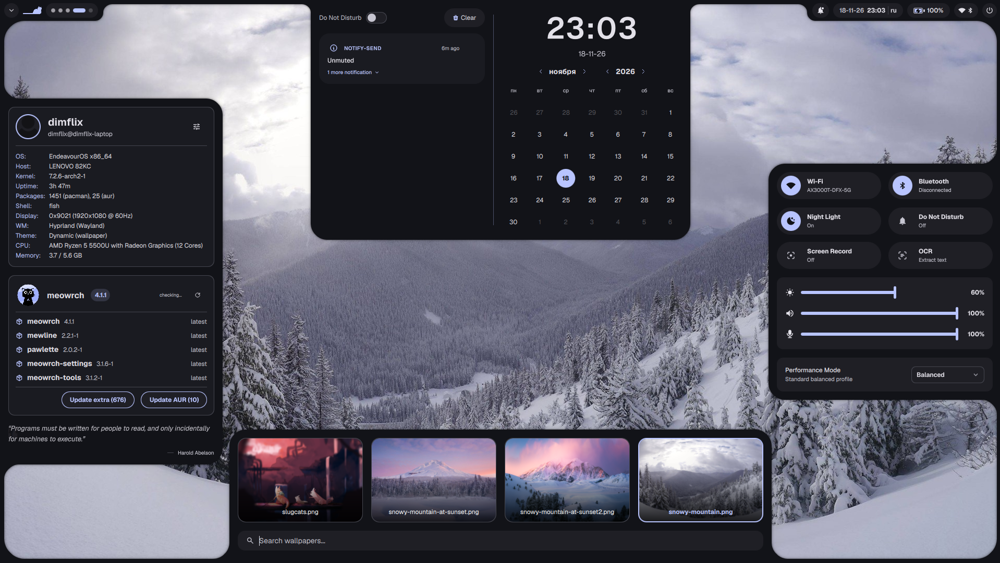
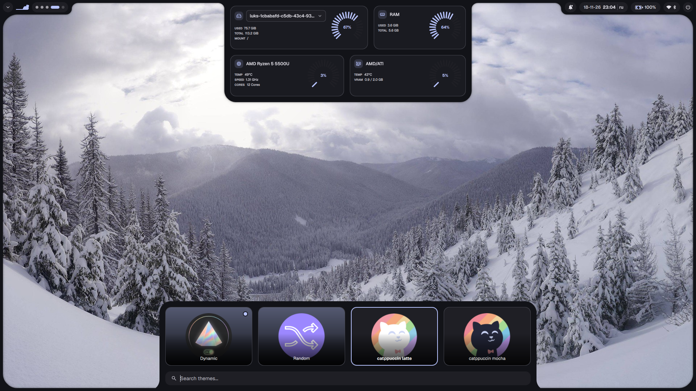
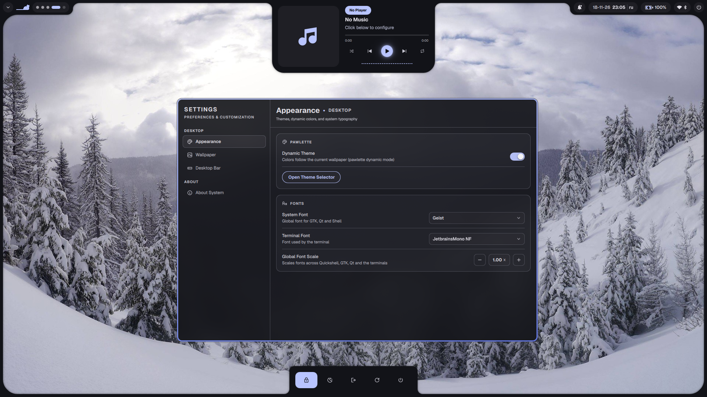

<div align="center">

<a href="https://github.com/meowrch/"></a>

# ≽ܫ≼ Mewline

### *The dynamic island, evolved.*
**A Quickshell shell for the [meowrch](https://github.com/meowrch/meowrch) distribution — Hyprland, niri & bspwm**

<br>

[]
[](https://github.com/meowrch/mewline-qs/issues)
[](./LICENSE)

[](./README.ru.md)
[](./README.md)

<br>

[🚀 Installation](#️-installation) • [📸 Gallery](#-visual-presentation) • [⌨️ Hotkeys](#️-hotkeys) • [🧩 Modules](#-modules)

[💬 Community](https://t.me/meowrch)

</div>

---

## 📸 Visual Presentation

<table align="center">
  <tr>
    <td colspan="3"></td>
  </tr>
  <tr>
    <td></td>
    <td colspan="2"></td>
  </tr>
</table>

---

## 🧩 Modules

### **Bar — compact interface, maximum information:**

- **System tray** — all your background applications
- **Workspaces** — quick switching between desktops
- **Date & time** with keyboard layout
- **Volume, brightness, microphone** — quick controls
- **Battery** with charging status
- **Wireless device batteries** — themed peripheral icons and charge bars in a compact island; [setup and hardware limits](docs/device-batteries.md)
- **Privacy dots** — mic / camera / screen-share / location indicators
- **Focused app** — icon and title of the active window
- **OCR** — text recognition from a selected screen area

### **Interactive control center:**

| Module | What it gives you | Keybind |
|:---|:---|:---:|
| **App launcher** | applications, files and shell commands | Super + Alt + A |
| **Dashboard** | system info, meowrch updates, quotes | Super + Alt + I |
| **Date & notifications** | big clock, calendar, notification history | Super + Alt + D |
| **Control center** | wifi, bluetooth, night light, DND, recorders, sliders | Super + Alt + B |
| **Wi-Fi networks** | straight to the network list | Super + Alt + N |
| **Bluetooth** | paired & available devices | Super + Alt + B |
| **Music** | MPRIS player with cava visualizer | Super + Alt + M |
| **System usage** | CPU / RAM / GPU / disks gauges | Super + Alt + U |
| **Clipboard** | clipboard history with actions | Super + Alt + V |
| **Wallpapers** | change wallpaper with live preview | Super + Alt + W |
| **Pawlette** | theme & accent variant selector | Super + Alt + T |
| **Power menu** | logout / reboot / shutdown / lock | Super + Alt + P |
| **Settings** | full shell configuration app | Super + Alt + O |

> [!NOTE]
> Yes-yes — **all of this is one utility**. \
> Instead of configuring Waybar + Rofi + Dunst + network-manager-applet + a clipboard manager —
> **one installation command**.

---

## <a name="installation"></a>🛠️ Installation

### 📦 From the AUR

```
# Stable release
yay -S mewline-qs
```

The package installs the shell to `/usr/share/mewline-qs` — run it in place
(pacman updates apply instantly, nothing lands in `~/.config`):

```
quickshell -p /usr/share/mewline-qs/quickshell
```

> [!TIP]
> Want to hack on the shell? Copy it first —
> `cp -r /usr/share/mewline-qs/quickshell ~/.config/quickshell` — and point
> your launchers at the copy.

### 🧑‍💻 From source

```
# 1. Clone the repository
git clone https://github.com/meowrch/mewline-qs --depth 1
cd mewline-qs

# 2. Launch it from the checkout
quickshell -p config/quickshell
```

> [!TIP]
> **bspwm users**: the autostart module `config/bspwm/default/quickshell.sh` tags the shell
> windows and keeps them alive — source it from your `bspwmrc`. The keyboard handover for
> menus (Esc, arrows) depends on those tags.

### ⚙️ Dependencies

**Hard requirement:** [quickshell](https://aur.archlinux.org/packages/quickshell) (AUR).

Everything else is optional and detected at runtime — cava (music visualizer), cliphist,
brightnessctl, grim/slurp/maim/satty (screenshots), ffmpeg (screen recording), pawlette (theming).
The full set lives in the AUR `optdepends` of the package.

---

## 📡 IPC & scripting

Every widget is addressable — unix sockets and IPC at the same time:

```
qs ipc call widgets toggle calendar
socat - UNIX-CONNECT:/tmp/quickshell_powerMenu
qs ipc call osd showVolume 40 false
```

---

## ⌨️ Hotkeys

| Action | Combination |
|:---|:---:|
| App launcher | Super + Alt + A |
| Dashboard / system info | Super + Alt + I |
| Date & notifications | Super + Alt + D |
| Control center | Super + Alt + B |
| Wi-Fi networks | Super + Alt + N |
| Clipboard history | Super + Alt + V |
| Wallpapers | Super + Alt + W |
| Pawlette themes | Super + Alt + T |
| Music player | Super + Alt + M |
| System usage | Super + Alt + U |
| Power menu | Super + Alt + P |
| Settings | Super + Alt + O |

---

## 💬 Support and Community

<div align="center">

**[🌐 Meowrch Wiki](https://meowrch.github.io/)** — guides, FAQ, troubleshooting

<br>

[](https://t.me/meowrch)
[](https://github.com/meowrch/mewline-qs/issues)

<br>

### ☕ Support the Project

| 💎 Cryptocurrency | 📬 Address |
|:---:|:---|
| **TON** | `UQB9qNTcAazAbFoeobeDPMML9MG73DUCAFTpVanQnLk3BHg3` |
| **Ethereum** | `0x56e8bf8Ec07b6F2d6aEdA7Bd8814DB5A72164b13` |
| **Bitcoin** | `bc1qt5urnw7esunf0v7e9az0jhatxrdd0smem98gdn` |
| **Tron** | `TBTZ5RRMfGQQ8Vpf8i5N8DZhNxSum2rzAs` |

</div>

---

<div align="center">

**Made with ❤️ and ≽ܫ≼ for the Linux community**

</div>
