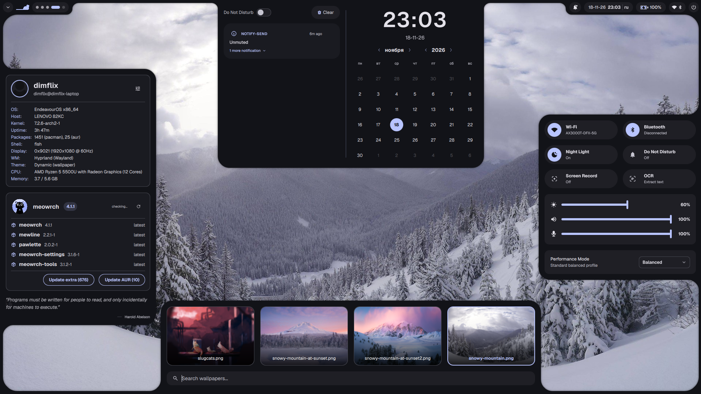
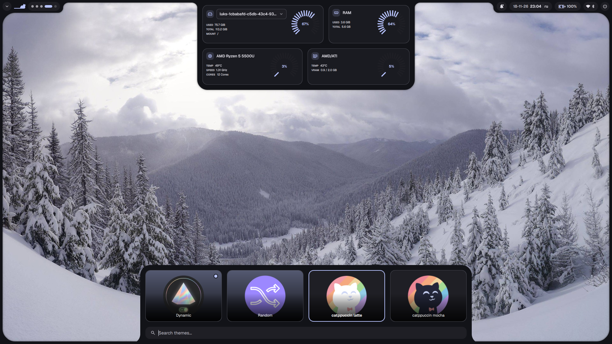
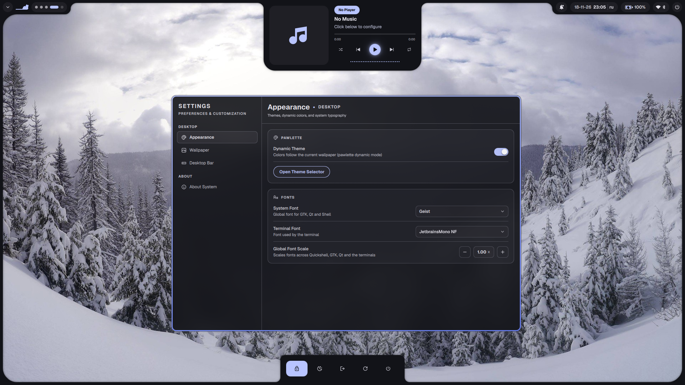

<div align="center">

<a href="https://github.com/meowrch/"></a>

# ≽ܫ≼ Mewline

### *Динамический остров. Следующая эволюция.*
**Quickshell-шелл для дистрибутива [meowrch](https://github.com/meowrch/meowrch) — Hyprland, niri и bspwm**

<br>

[]
[](https://github.com/meowrch/mewline-qs/issues)
[](./LICENSE)

[](./README.ru.md)
[](./README.md)

<br>

[🚀 Установка](#️-установка) • [📸 Галерея](#-визуальное-представление) • [⌨️ Горячие клавиши](#️-горячие-клавиши) • [🧩 Модули](#-модули)

[💬 Сообщество](https://t.me/meowrch)

</div>

---

## 📸 Визуальное представление

<table align="center">
  <tr>
    <td colspan="3"></td>
  </tr>
  <tr>
    <td></td>
    <td colspan="2"></td>
  </tr>
</table>

---

## 🧩 Модули

### **Бар — компактный интерфейс, максимум информации:**

- **Системный трей** — все фоновые приложения
- **Воркспейсы** — быстрое переключение между столами
- **Дата и время** с индикатором раскладки
- **Громкость, яркость, микрофон** — быстрые контролы
- **Батарея** с статусом зарядки
- **Заряд беспроводных устройств** — иконки периферии и полоски заряда в отдельной компактной капсуле; [настройка и ограничения](docs/device-batteries.md)
- **Privacy dots** — индикаторы микрофона / камеры / записи экрана / геолокации
- **Активное окно** — иконка и название приложения в фокусе
- **OCR** — распознавание текста с выбранной области экрана

### **Интерактивный центр управления:**

| Модуль | Что даёт | Хоткей |
|:---|:---|:---:|
| **Лончер** | приложения, файлы и команды шелла | Super + Alt + A |
| **Дашборд** | информация о системе, обновления meowrch, цитаты | Super + Alt + I |
| **Дата и уведомления** | большие часы, календарь, история уведомлений | Super + Alt + D |
| **Контроль центр** | wifi, bluetooth, night light, DND, запись, слайдеры | Super + Alt + B |
| **Wi-Fi сети** | сразу к списку сетей | Super + Alt + N |
| **Bluetooth** | сопряжённые и доступные устройства | Super + Alt + B |
| **Музыка** | MPRIS-плеер с визуализатором cava | Super + Alt + M |
| **Нагрузка системы** | графики CPU / RAM / GPU / дисков | Super + Alt + U |
| **Буфер обмена** | история буфера с действиями | Super + Alt + V |
| **Обои** | смена обоев с живым предпросмотром | Super + Alt + W |
| **Pawlette** | селектор тем и акцентных вариантов | Super + Alt + T |
| **Меню питания** | logout / reboot / shutdown / lock | Super + Alt + P |
| **Настройки** | полноценное приложение конфигурации шелла | Super + Alt + O |

> [!NOTE]
> Да-да — **всё это одна утилита**. \
> Вместо настройки Waybar + Rofi + Dunst + network-manager-applet + менеджера буфера —
> **одна команда установки**.

---

## <a name="installation"></a>🛠️ Установка

### 📦 Из AUR

```
# Стабильная версия
yay -S mewline-qs
```

Пакет ставит шелл в `/usr/share/mewline-qs` — запускайте прямо оттуда
(обновления через pacman применяются сразу, в `~/.config` ничего не попадает):

```
quickshell -p /usr/share/mewline-qs/quickshell
```

> [!TIP]
> Хотите ковыряться в шелле? Сначала скопируйте —
> `cp -r /usr/share/mewline-qs/quickshell ~/.config/quickshell` — и
> направьте лончеры на копию.

### 🧑‍💻 Из исходников

```
# 1. Клонируем репозиторий
git clone https://github.com/meowrch/mewline-qs --depth 1
cd mewline-qs

# 2. Запускаем из чекаута
quickshell -p config/quickshell
```

> [!TIP]
> **Пользователям bspwm**: модуль автостарта `config/bspwm/default/quickshell.sh` тегирует окна
> шелла и держит их живыми — подключите его в свой `bspwmrc`. Передача клавиатуры для меню
> (Esc, стрелки) зависит от этих тегов.

### ⚙️ Зависимости

**Жёсткое требование:** [quickshell](https://aur.archlinux.org/packages/quickshell) (AUR).

Всё остальное — опционально и детектится в рантайме: cava (визуализатор музыки), cliphist,
brightnessctl, grim/slurp/maim/satty (скриншоты), ffmpeg (запись экрана), pawlette (темизация).
Полный набор — в `optdepends` AUR-пакета.

---

## 📡 IPC и скриптинг

Каждый виджет адресуем — unix-сокеты и IPC одновременно:

```
qs ipc call widgets toggle calendar
socat - UNIX-CONNECT:/tmp/quickshell_powerMenu
qs ipc call osd showVolume 40 false
```

---

## ⌨️ Горячие клавиши

| Действие | Комбинация |
|:---|:---:|
| Лончер приложений | Super + Alt + A |
| Дашборд / информация о системе | Super + Alt + I |
| Дата и уведомления | Super + Alt + D |
| Контроль центр | Super + Alt + B |
| Wi-Fi сети | Super + Alt + N |
| История буфера обмена | Super + Alt + V |
| Обои | Super + Alt + W |
| Темы Pawlette | Super + Alt + T |
| Музыкальный плеер | Super + Alt + M |
| Нагрузка системы | Super + Alt + U |
| Меню питания | Super + Alt + P |
| Настройки | Super + Alt + O |

---

## 💬 Поддержка и сообщество

<div align="center">

**[🌐 Вики Meowrch](https://meowrch.github.io/)** — гайды, FAQ, решение проблем

<br>

[](https://t.me/meowrch)
[](https://github.com/meowrch/mewline-qs/issues)

<br>

### ☕ Поддержать проект

| 💎 Криптовалюта | 📬 Адрес |
|:---:|:---|
| **TON** | `UQB9qNTcAazAbFoeobeDPMML9MG73DUCAFTpVanQnLk3BHg3` |
| **Ethereum** | `0x56e8bf8Ec07b6F2d6aEdA7Bd8814DB5A72164b13` |
| **Bitcoin** | `bc1qt5urnw7esunf0v7e9az0jhatxrdd0smem98gdn` |
| **Tron** | `TBTZ5RRMfGQQ8Vpf8i5N8DZhNxSum2rzAs` |

</div>

---

<div align="center">

**Сделано с ❤️ и ≽ܫ≼ для Linux-сообщества**

</div>
